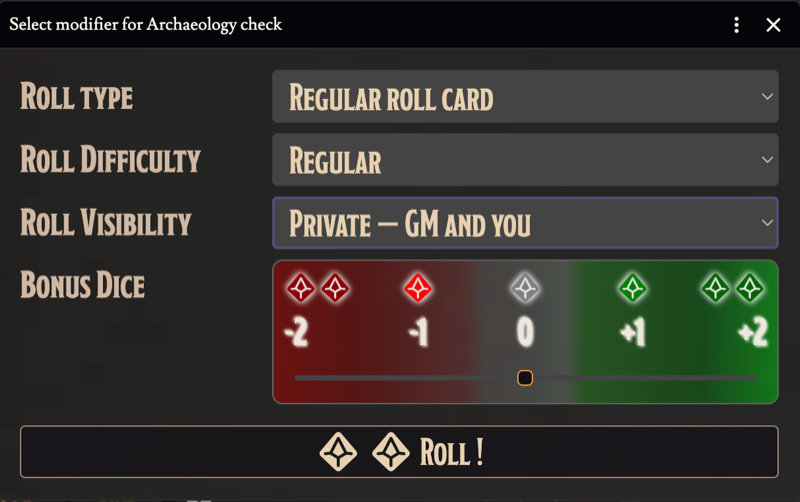
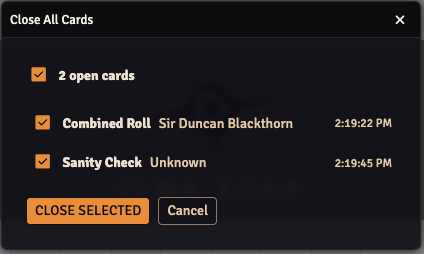
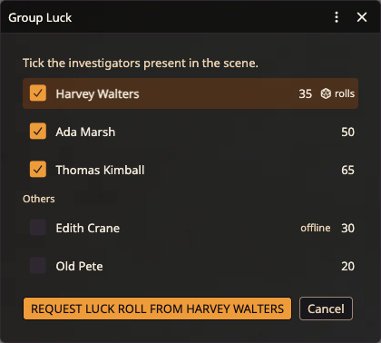
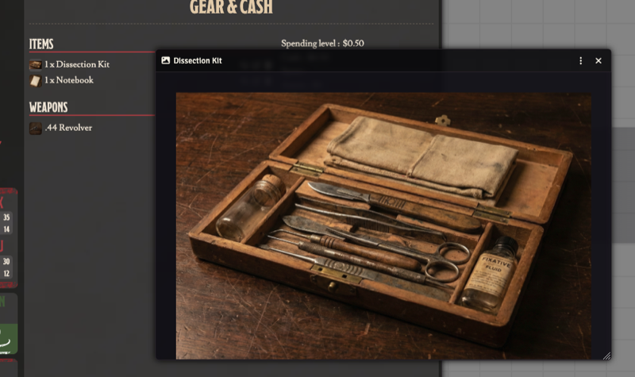
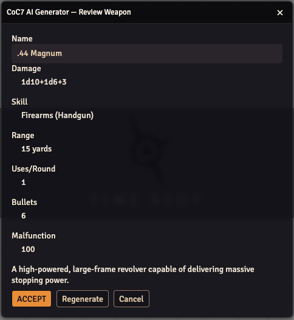
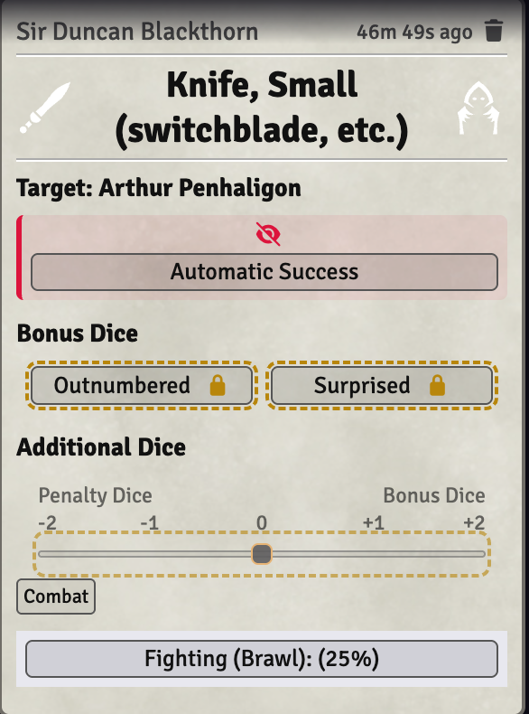
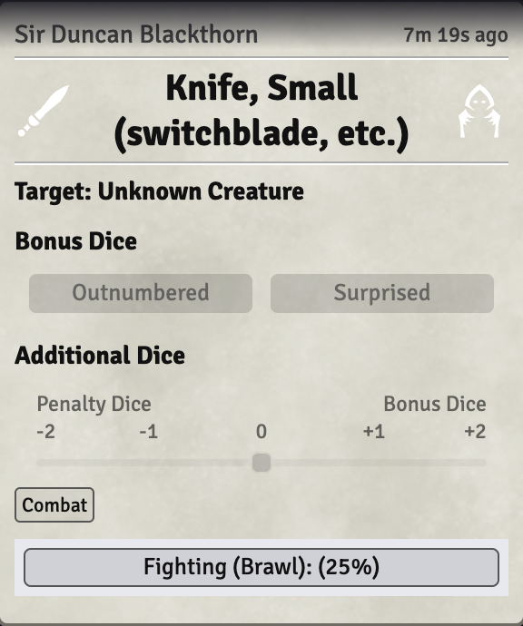
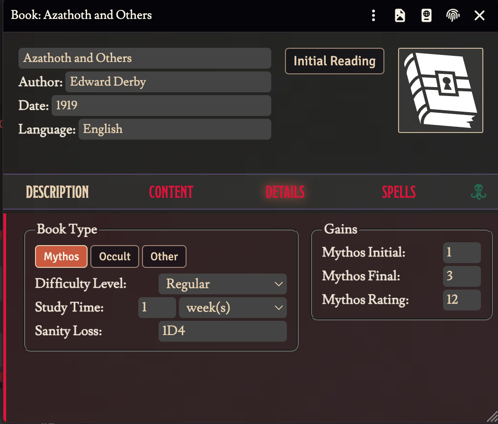
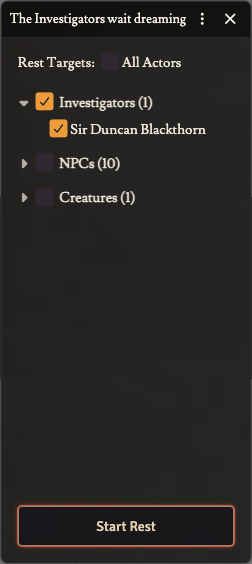
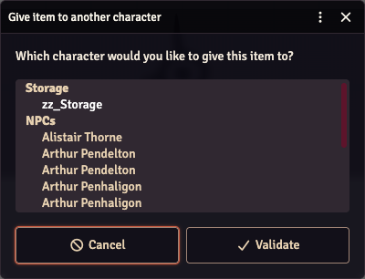

# CoC7 QoL Improvements

A module for the Call of Cthulhu 7th Edition (CoC7) system on FoundryVTT. Adds a dice roll visibility selector, bulk closing of chat cards, Group Luck rolls, item image popouts, AI-powered weapon and NPC generation, keeper-only highlights, grouped Rest and Trade / Store targets, resizable NPC and Creature sheets, casting spells straight from the actor sheet, and a highlight for strong skills.

## Have an idea or a feedback ?

If there's a workflow that annoys you, a small thing that could be smoother, or a feature you keep wishing existed — feel free to open a [GitHub issue](https://github.com/martin-papy/coc7-qol/issues) and describe it. A short note is plenty.

<a href='https://ko-fi.com/E7O820GI4E' target='_blank'></a>

## What's inside

| Feature | What it does | For |
|---|---|---|
| [🎲 Roll Visibility Selector](#-roll-visibility-selector) | Easily pick public / private / blind per roll — and remember your last choice | Everyone |
| [🗂️ Close All Cards](#-close-all-cards) | Sweep stale chat cards out of the way in one click | GM |
| [🍀 Group Luck](#-group-luck) | Find who rolls Group Luck and send them the request in two clicks | GM |
| [🖼️ Item Image Popouts](#-item-image-popouts) | Click any item portrait to see it full size, draggable, resizable | Everyone |
| [✨ AI Generation](#-ai-generation) | Conjure fully-statted weapons and NPCs from a one-line description | GM |
| [👁️ Keeper-Only Highlights](#-keeper-only-highlights) | See what players can't see vs can't change, on sheets and chat cards | GM |
| [🛏️ Grouped Rest Targets](#-grouped-rest-targets) | Rest just the Investigators in two clicks — actors grouped by type, PCs pre-selected | GM |
| [🎁 Grouped Trade / Store Targets](#-grouped-trade--store-targets) | Give or store an item without scanning a flat list — targets grouped Investigators / Storage / NPCs / Creatures | Everyone |
| [↔️ Resizable NPC Sheets](#-resizable-npc-sheets) | Drag NPC and Creature sheets to any size — they scroll inside, stay on screen, and list skills in columns | Everyone |
| [🪄 Cast Spells from the Sheet](#-cast-spells-from-the-sheet) | Cast a spell in one click from its row on the actor sheet — no need to open the spell first | Everyone |
| [💪 Strong Skills at a Glance](#-strong-skills-at-a-glance) | See what a character is good at without re-sorting — skills at 50% or more are highlighted | Everyone |

---

## 🎲 Roll Visibility Selector

The CoC7 bonus/penalty dialog now sports a **visibility** dropdown — public, private, or blind. Makes the use Private/Blind rolls way easier. Your last choice sticks per user and is preserved across the standby.

Small change. Big difference once you've made fifty rolls in a session.



[**Read more →**](docs/features/roll-visibility.md)

---

## 🗂️ Close All Cards

Open the Keeper's toolbar (the tentacle-strike icon), click **Close All Cards**, and pick exactly which lingering chat cards to dismiss — listed by type, actor, and timestamp. Particularly useful when accumulated open cards start blocking new rolls.



[**Read more →**](docs/features/close-all-cards.md)

---

## 🍀 Group Luck

The investigator with the lowest Luck among those present rolls Luck for the group. Open the Keeper's toolbar, click **Group Luck**, and tick who is in the scene: the lowest Luck is highlighted, and one click whispers that player a **Luck check** link. Ties let you pick who rolls, and if the player is offline you roll Luck for them.



[**Read more →**](docs/features/group-luck.md)

---

## 🖼️ Item Image Popouts

Players can finally click on an item's portrait and see the actual art — no GM-only file picker getting in the way. Works on the item sheet itself and on the small icons in the Gear & Cash tab. GMs keep their default editing behavior where it makes sense.



[**Read more →**](docs/features/item-image-popouts.md)

---

## ✨ AI Generation

Open the Create Item dialog, pick **Weapon**, and a sparkle icon appears. Type *"A worn 1920s revolver, .38 calibre, 6-shot cylinder, wood grip"* and get a fully-statted CoC7 weapon back — skill, damage, range, ammo, malfunction. Or pick **NPC** in the Create Actor dialog and describe a character (*"A nervous pharmacist in 1920s Arkham, middle-aged, hides a laudanum habit"*) to get the full stat block, skills resolved against the official CoC7 compendium, weapons, possessions, biography, and Keeper notes — ready to drop on the canvas.

Plug in your own key for **Anthropic Claude**, **OpenAI GPT**, or **Google Gemini** under **Settings → Module Settings → CoC7 QoL Improvements**. Your prompt goes straight to the provider you chose — the module doesn't proxy your traffic.



[**Read the full walkthrough →**](docs/features/ai-generation.md)

---

## 👁️ Keeper-Only Highlights

See at a glance which parts of item sheets and chat cards your players **can't see** — and which they **can see but can't change**. Content hidden from players gets a solid crimson outline and an 👁️ badge; read-only controls (visible to players but locked) get a dashed amber outline and a 🔒 badge. Keeper-only and on by default; toggle it under **Settings → Module Settings → CoC7 QoL Improvements**.

| Keeper's view | The same card, player's view |
|---|---|
|  |  |

Item sheets follow the same idea — the non-obvious Keeper-only tabs are marked, while the self-explanatory Keeper's Notes tab is left alone:



---

## 🛏️ Grouped Rest Targets

CoC7's **Start Rest** dialog lists every actor in the world in one flat, unticked list. Now it's grouped into **Investigators / NPCs / Creatures / Vehicles**, the Investigators come pre-selected and expanded, and every group heading has its own select-all checkbox. Resting the party is two clicks; resting every NPC is three.



[**Read more →**](docs/features/rest-targets.md)

---

## 🎁 Grouped Trade / Store Targets

The **Trade / Store Item** dropdown on the character sheet listed every visible actor in world order. It's now grouped into **Investigators / Storage / NPCs / Creatures** and nothing pre-selected — **Validate** waits until you've actually picked someone — so handing a clue to a fellow investigator or stashing a rifle in storage is one glance instead of a scroll.



[**Read more →**](docs/features/trade-targets.md)

---

## ↔️ Resizable NPC Sheets

NPC and Creature sheets can now be **resized** like any other window: drag the bottom-right corner to the size you want, and the sheet scrolls inside it. Open as many sections as you like — the sheet stays on screen instead of running off the bottom.

Skills also read **down each column**, like on the investigator sheet, and a wider sheet shows more columns.

Both are on by default. The Keeper can switch either one off under **Settings → Module Settings → CoC7 QoL Improvements**.

---

## 🪄 Cast Spells from the Sheet

Every spell listed on an investigator, NPC or Creature sheet gets a **cast icon** at the start of its row. Click it and the spell is cast exactly as if you had opened it and pressed *Cast*: same chat card, same costs taken from the caster.

The icon is there for anyone who owns the actor. The Keeper can also **right-click** it to cast hidden, so only the Keeper sees the card.

---

## 💪 Strong Skills at a Glance

Keep your skills sorted by name and still see what a character is good at: every skill at **50% or more** gets a soft tint, a bar on its left edge and a bold name. It works on investigator, NPC and Creature sheets, in the light and the dark theme.

It is on by default. The Keeper can change the threshold or switch it off for the whole table under **Settings → Module Settings → CoC7 QoL Improvements**.

---

## Internationalization

All user-visible strings flow through FoundryVTT's i18n system. Currently shipping with:

- **English** (en)
- **Français** (fr)

Dialogs, buttons, settings, and notifications follow your configured Foundry language. PRs for additional languages are very welcome.

## Installation

### From FoundryVTT

1. Go to **Settings > Manage Modules > Install Module**
2. Paste the manifest URL:
   ```
   https://github.com/martin-papy/coc7-qol/releases/latest/download/module.json
   ```
3. Click **Install**

### Manual

1. Download `coc7-qol.zip` from the latest release on the [Releases](https://github.com/martin-papy/coc7-qol/releases) page
2. Create a new `Data/modules/coc7-qol/` folder and extract the zip into it (the zip has no top-level folder, so `module.json` should end up directly inside `coc7-qol/`)
3. Restart FoundryVTT

## Compatibility

- **FoundryVTT:** v13+
- **System:** Call of Cthulhu 7th Edition (CoC7) — v8.16+ and v9.x

## AI Usage Disclaimer

This module has been developped with the help of an AI Coding assistant (Claude Code). The code has been thoroughly reviewed and tested by a human (me).

## License

[MIT](LICENSE)
