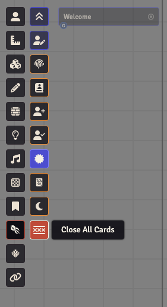
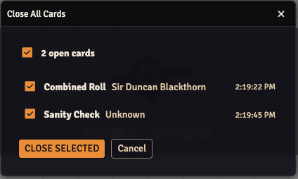

# 🗂️ Close All Cards

> Sweep stale chat cards out of the way in one click. **GM only.**

In long sessions, half-finished chat cards stack up — unresolved rolls, opposed checks, combat actions left dangling. CoC7 sometimes refuses to start a new roll while an old one is still open, and scrolling back through the chat log to close each card by hand is nobody's idea of fun.

This tool gives you a quick way to clean them out — without nuking the chat log itself.

## How to use it

1. Click the tentacle-strike icon in the scene controls toolbar to open the Keeper's tools
2. Click the **Close All Cards** button (the ╳-lines icon)

   

3. A dialog lists the open roll cards in the chat log with their type, actor name, state and timestamp
4. Finished cards are already selected. Tick any other card you also want closed, or use the select-all checkbox

   

5. Click **Close Selected**

The chat log itself stays intact — only the open/interactive state of each card is closed.

## Which cards are listed

Skill and attribute checks, sanity checks, opposed rolls and combined rolls. These are the cards CoC7 itself marks as closed once they are done.

Melee, ranged, damage, Constitution and chase obstacle cards are not listed: CoC7 never marks them as closed, so there is nothing to close.

## What closing does

Each card shows one of three states:

| State | Meaning | Selected by default | What closing does |
|-------|---------|---------------------|-------------------|
| **Finished** | The roll is resolved and the card shows CoC7's own **Close card** button | Yes | The module presses that button for you, so the result is exactly what CoC7 does: action buttons removed, and the skills that earned it flagged for development on opposed and combined rolls |
| **In progress** | Started but not finished: an opposed or combined roll with dice still to roll, a sanity check mid-way, a winner who has not rolled damage | No | The card is marked closed, so CoC7 stops adding new rolls to it. Its buttons stay until CoC7 redraws the card. Nothing is flagged for development |
| **Waiting for roll** | A roll the Keeper requested and nobody has made yet | No | The card is marked closed. If someone rolls it later, the result comes without Push, Luck or bonus-die buttons |

Closing an unfinished card abandons its roll, which is why you have to select it yourself.

If CoC7 does not answer when its button is pressed, the module closes that card on its own: the action buttons are removed, the difficulty buttons of an unknown-difficulty roll are kept, and nothing is flagged for development.

If some cards cannot be closed, an error says how many, and the dialog stays open with the cards that are still open.

---

[← Back to README](../../README.md)
