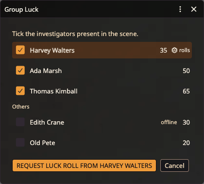

# 🍀 Group Luck

> Find out who rolls Luck for the group and send them the request in two clicks. **GM only.**

When the investigators face a Group Luck roll, the one with the lowest Luck among those present in the scene rolls for everyone. CoC7 has no help for this, so the players end up comparing their sheets to work out who that is, and the Keeper then has to ask that player to roll.

This tool finds the investigator, shows you why, and sends the request.

## How to use it

1. Click the tentacle-strike icon in the scene controls toolbar to open the Keeper's tools
2. Click the **Group Luck** button (the four-leaf clover icon, after **Close All Cards**)
3. A dialog lists every investigator that has a player owner and a Luck value, with its Luck. Tick the investigators present in the scene

   

4. The investigator with the lowest Luck among those ticked is highlighted and marked *rolls*. Click **Request Luck roll from** that investigator
5. The player gets a chat message with a **Luck check** link. Clicking it opens the usual CoC7 Luck roll dialog, and the roll card is what the rest of the table sees

Each connected player's assigned character is ticked for you. When a player has no assigned character, every investigator that player owns is ticked. Investigators of offline players (tagged *offline*) and spare, retired or dead investigators are listed under **Others**, unticked. The highlight and the button follow your ticks.

## Ties

When several ticked investigators share the lowest Luck, each of them gets a radio button and you pick who rolls.

## Offline players

When none of the players behind the chosen investigator is connected, the button reads **Roll Luck for** that investigator and opens the Luck roll on your side instead. No request is sent. If CoC7's *Standby Keeper rolls* setting is on, the roll first appears in chat as a card with a roll button instead of rolling straight away.

## The request is a whisper

The message goes only to the investigator's player (or players). It is not public because any player could click a public link and roll their own Luck. With a single investigator ticked, the message reads "Harvey Walters rolls Luck for the group."

---

[← Back to README](../../README.md)
