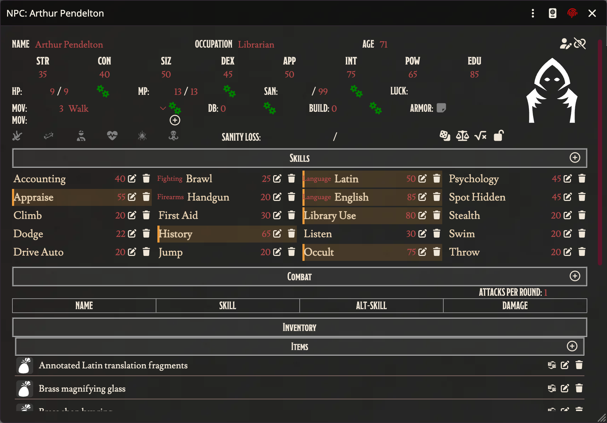

# ↔️ Resizable NPC Sheets

> NPC and Creature sheets that you can resize, and that stay on screen.

CoC7 gives NPC and Creature sheets a fixed window that grows with its content. Open a few sections and the sheet runs off the bottom of the screen, with no way to scroll to what is below.

## What changes

- **Resize handle.** Drag the bottom-right corner to the size you want, like any other window.
- **The sheet scrolls inside its window**, whatever size you give it.
- **It stays on screen.** Opening a section no longer pushes the window past the bottom edge.
- **Skills read down each column**, like on the investigator sheet, instead of across each row. A wider sheet shows more columns.

## Settings

Both are on by default. The Keeper can switch either off under **Settings → Module Settings → CoC7 QoL Improvements → NPC and Creature Sheets**:

- **Resizable**: the resize handle, the inner scroll and keeping the sheet on screen. Changing it reloads the page, because the window frame is built when the world loads.
- **Skills in columns**: the column order of the skill list.

Both apply to everyone in the world.
