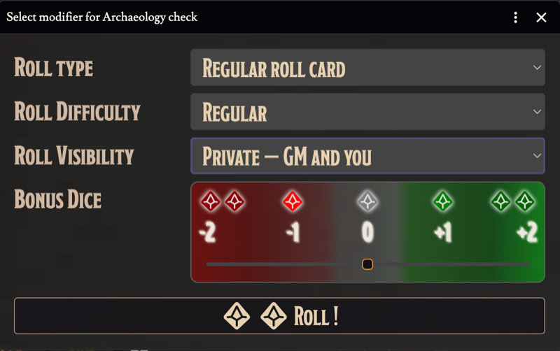

# 🎲 Roll Visibility Selector

> Stop re-picking visibility every single roll.

The CoC7 bonus/penalty dialog now includes a **roll visibility** dropdown with three options:

- **Public — visible to all**
- **Private — GM and you**
- **Blind — GM only**

## What changes in practice

- **Your last choice is remembered, per user.** Next time you roll, the dropdown is already on the visibility you usually use — no re-picking.
- **Standby → resolve preserves visibility.** When a deferred roll comes back to be resolved later in the round, it keeps the visibility you set when you queued it.

- **A blind roll picked here is a real CoC7 blind roll.** The Keeper gets the usual *Reveal*, *Force pass*, *Force fail* and *Flag for development* buttons, and a success does not tick the skill on the player's sheet — exactly as when the chat box itself is set to Blind. The other way round works too: with the chat box on Blind, picking Public or Private gives an ordinary card and the usual development tick.

Small change. Big difference once you've made fifty rolls in a session.

## How the blind roll is kept blind

CoC7 builds the roll under the chat box's visibility before the dialog's choice is known. When the choice changes whether the roll is blind, the module corrects the card as soon as it is posted:

- the card is redrawn by CoC7's own **Refresh** action (the one in a chat card's right-click menu), so it is the card CoC7 would have made;
- for a roll turned blind, the development tick CoC7 was about to write is cancelled.

This applies to skill, characteristic and attribute checks. A sanity check takes the chosen visibility too, but its card is not redrawn.

---

[← Back to README](../../README.md)
