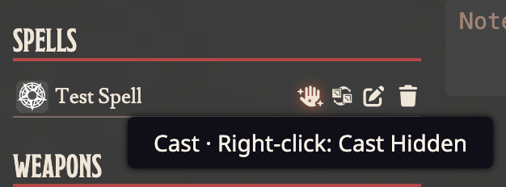

# 🪄 Cast Spells from the Sheet

> Cast a spell from the actor sheet without opening it first.

Each spell listed on an investigator, NPC or Creature sheet gets a **cast icon**, the first of its row's controls.

## How it works

- **Click the icon** to cast the spell exactly as the spell's own sheet would: same chat card, and the same costs taken from the caster.
- A spell with no automated costs gets the spell sheet's other action instead: the icon posts its description to chat.
- The tooltip names what the click will do.

## Who sees it

- **Anyone who owns the actor**: the player for their investigator, the Keeper for everything. This is the same rule as the Cast buttons on the spell sheet.
- **The Keeper can right-click** the icon to cast hidden, so only the Keeper sees the card. The tooltip says so for the Keeper only.

There is no setting: the icon only shortens the way to an action the system already offers.
