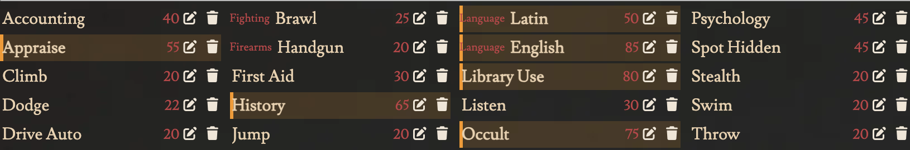

# 💪 Strong Skills at a Glance

> Keep skills sorted by name and still see what a character is good at.

Skill lists are sorted by name, so a character's strengths are scattered among skills at their base value. This marks every skill at or above a threshold (**50%** by default) with a soft tint, a bar on its left edge and a bold name.

It works on investigator, NPC and Creature sheets, in the light and the dark theme, and follows the skill's current value.

## Settings

Under **Settings → Module Settings → CoC7 QoL Improvements → Strong Skills**, the Keeper can:

- switch the highlight off with **Highlight strong skills**;
- change the **Strong skill threshold**, from 1 to 99.

Both apply to everyone in the world.
